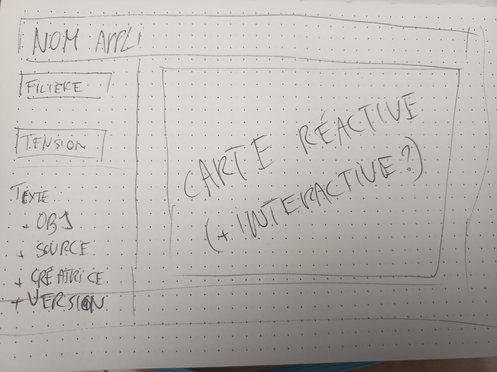
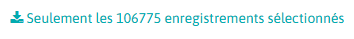

[{fig-align="center"}](https://500px.com/p/antoinemach)

::: {.callout-note icon="false"}
[**Twitch du 12 octobre 2026**](https://www.twitch.tv/videos/2898786046).\

Le code est disponible sur [GitHub](https://github.com/Vaugoyeau/twitch_choroplethe) 😊
:::

# Avant de commencer  
## Un choroplèthe      

::: callout-tip
Le choroplèthe est une représentation qui permet de visualiser les valeurs d'une variable dans une représentation géographique.  
Généralement, c'est la couleur qui permet de connaîtres le niveau de valeur. 
:::

Une représentation créée par [Charles Dupin](https://fr.wikipedia.org/wiki/Charles_Dupin) au 19ème siècle.    
  
  
## Les données  
Les données utilisées sont celles du fichier de données [Registre national des installations de production et de stockage d'électricité](https://odre.opendatasoft.com/explore/dataset/registre-national-installation-production-stockage-electricite-agrege/) disponible sur le [site de ODRE](https://odre.opendatasoft.com/assets/theme_image/logo-odre.svg) 

Les données sont manipulées grâce aux fonctions de `{dplyr}` pour réaliser un tableau résumé contenant la **puissance maximale cumulée** sur toutes les installations en fonction des modalités des colonnes `region`, `filiere` et `tensionRaccordement`   


## Démarche  
➡️ importer des données en ligne  
🧹 les préparer  
🗺️ récupérer un fond de carte  
🎨 créer le choroplèthe avec {ggplot2}  
🔁 l'intégrer dans une appli pour le rendre réactif  
  
## Maquette de l'appli  
{#fig-maquette}   

Les parties `filière` et `tension` sont des sélecteurs pour que l'utilisateurice puisse **choisir le type de filière et le(s) tension(s) de raccordement** à représenter sur le choroplèthe.  

# Réalisation  
## Importer des données     
Les données sont importées directement depuis le site grâce à l'utilisation de la fonction `read_delim()` du package `{readr}`.  
Seules les colonnes d'intérêt sont utilisées grâce à l'argument `col_select`.  
  
```{r}
#| warning: false

library(tidyverse)

donnees_odre <- read_delim(
  "https://odre.opendatasoft.com/api/explore/v2.1/catalog/datasets/registre-national-installation-production-stockage-electricite-agrege/exports/csv?lang=fr&refine=regime%3A%22En%20service%22&facet=facet(name%3D%22regime%22%2C%20disjunctive%3Dtrue)&timezone=Europe%2FBerlin&use_labels=true&delimiter=%3B",
  col_select = c(region, filiere, tensionRaccordement, puisMaxInstallee)
)
```

::: callout-tip
Pour limiter le nombre de lignes utilisées j'ai rtéduis sur le site en sélectionnant dans la partie **regime** `En service`.  
Puis en cliquant sur les enregistrements sélectionnées (clique droit) :   
:::  

## Préparation des données  
Je commence à supprimer les lignes pour lesquelle la région n'est pas précisée (`NA`) grâce à la fonction `drop_na()` du package `{tidyr}`   
```{r}
donnees_odre |> 
  drop_na(region)
```

Comme je souhaite obtenir une table résumée en fonction de la `region`, la `filière` et la `tensionRaccordement`, j'utilise `group_by()` avant le `summarise()`.  
  
```{r}
(donnees_odre <- donnees_odre |> 
  drop_na(region) |> 
  group_by(
    region,
    filiere,
    tensionRaccordement
  ) |> 
  summarise(
    puissance_max_cumulee = sum(puisMaxInstallee)/1000
  ) |> 
  ungroup())
```
  
::: callout-warning
Il ne faut pas oublier de retirer les groupes avec la fonction `ungroup()`.  
:::  
  
## Création d'un fond de carte  
Le fond de carte est à l'origine un tableau de données contenant le tracé des différentes régions, récupérée via `map_data()` du package `{ggplot2}` (nécessite d'avoir le package `{maps}` présent).  

```{r}
fond_de_carte <-
  map_data("france")
```

L'affichage de la table montre que les `regions` sont en fait les départements.  
Il faut donc utiliser une table contenant les noms des départements et des régions de France sur le [site de `data gouv`](https://www.data.gouv.fr/datasets/departements-et-leurs-regions) puis réaliser la jointure.  

```{r}
fond_de_carte <-
  map_data("france") |> 
  left_join(
    read_delim(
      "https://www.data.gouv.fr/api/1/datasets/r/987227fb-dcb2-429e-96af-8979f97c9c84"
    ),
    by = join_by("region" == "dep_name")
  )
```

J'utilise ensuite la fonction de filtre de `{dplyr}` pour vérifier qu'il n'y a pas de département non reconnu.  

```{r}
fond_de_carte |> 
  filter(region_name |>  is.na()) |> 
  distinct(region)
```

`23 départements` sont mal reconnus.  
Principalement à cause des accents.  

J'utilise donc la fonction `str_replace()` du package `{stringr}` pour modifier les noms des départements dans la table issu du site de `data gouv` à l'intérieur d'une fonction `mutate()` de `{dplyr}` et je ne garde que les colonnes d'intéret.   

```{r}
fond_de_carte <-
  map_data("france") |> 
  left_join(
    read_delim(
      "https://www.data.gouv.fr/api/1/datasets/r/987227fb-dcb2-429e-96af-8979f97c9c84"
    ) |> 
      mutate(
        nom_dept = dep_name |> 
          str_replace_all("[éèëê]", "e") |> 
          str_replace_all("[ôö]", "o") |> 
          str_replace("d'O", "Do") |> 
          str_replace("d'A", "Da") |> 
          str_replace("Corse-du-Sud", "Corse du Sud")
      ),
    by = join_by("region" == "nom_dept")
  ) |> 
  select(long, lat, group, region = region_name)
```

::: callout-tip
## `str_replace()` ou `str_replace_all()`  

Les fonctions `Str_replace()` et `str_replace_all()` du package `{stringr}` permettent de remplacer un `pattern` par une chaîne de remplacement.  

- `str_replace()` : ne le fait qu'une seule fois donc `str_replace("Pyrénées", "[éèëê]", "e")` donne `Pyrenées`    
- `str_replace_all()` : le fait autant de fois qu'il rencontre le `pattern` donc `str_replace_all("Pyrénées", "[éèëê]", "e")` donne `Pyrenees`  
:::  
  
## Paramétrer le choroplèthe avec {ggplot2}   
### Création de paramètres   
Choix de paramètres qui sera ensuite utilisés pour filtrer les données résumées  
```{r}
type_filiere <- "Solaire"
type_tension <- c("HTA", "BT")
```

### Jointure et représentation des données  
Jointure du fond de carte avec la table filtrée pour ensuite représenter les données grâce à `{ggplot2}`  
```{r}
full_join(
  fond_de_carte,
  donnees_odre |> 
    filter(
      filiere == type_filiere,
      tensionRaccordement %in% type_tension
    ),
  by = join_by("region" == "region")
) |> 
  ggplot() +
  aes(
    x = long,
    y = lat,
    group = group,
    fill = puissance_max_cumulee
  ) +
  geom_polygon(color = "black") +
  labs(
    title = 
      paste("Tension de raccordement : ", type_tension |> str_c(collapse = ' / '), " \n Filière : ", type_filiere)
  ) +
  theme_void() +
  scale_fill_gradient(low = "#faebed", high = "#01066b")
```

::: callout-tip
Je modifie le gradient de couleur utilisée qui n'est pas dans le bon sens par défaut dans `{ggplot2}` : les valeurs les plus faibles doivent avoir la couleur la moins soutenue.   
:::

## Intégrer la carte dans une appli
### Structure de l'appli  
Je créé un nouveau fichier `.R` puis j'ajoute la structure d'une appli shiny.  

::: callout-tip
Pour générer facilement le squelette d'une appli, taper `shinyapp` puis taper sur `Entrée` pour utiliser le `snippet`.  
:::  

```{r}
#| eval: false 
  
library(shiny)

ui <- fluidPage(
  
)

server <- function(input, output, session) {
  
}

shinyApp(ui, server)
```

### import des données  
Avant la partie `ui` j'importe les packages et les données nécessaires  

```{r}
#| eval: false
  
#### Avant de commencer ####  

# import des packages ----
library(shiny)
library(tidyverse)
library(bslib)

# import des données ----
## données depuis le site ODRE : https://opendata.reseaux-energies.fr/
donnees_odre <- read_delim(
  "https://odre.opendatasoft.com/api/explore/v2.1/catalog/datasets/registre-national-installation-production-stockage-electricite-agrege/exports/csv?lang=fr&refine=regime%3A%22En%20service%22&facet=facet(name%3D%22regime%22%2C%20disjunctive%3Dtrue)&timezone=Europe%2FBerlin&use_labels=true&delimiter=%3B",
  col_select = c(region, filiere, tensionRaccordement, puisMaxInstallee)
) |> 
  drop_na(region) |> 
  group_by(
    region,
    filiere,
    tensionRaccordement
  ) |> 
  summarise(
    puissance_max_cumulee = sum(puisMaxInstallee)/1000
  ) |> 
  ungroup()

## création du fond de carte
fond_de_carte <-
  map_data("france") |> 
  left_join(
    read_delim(
      "https://www.data.gouv.fr/api/1/datasets/r/987227fb-dcb2-429e-96af-8979f97c9c84"
    ) |> 
      mutate(
        nom_dept = dep_name |> 
          str_replace_all("[éèëê]", "e") |> 
          str_replace_all("[ôö]", "o") |> 
          str_replace("d'O", "Do") |> 
          str_replace("d'A", "Da") |> 
          str_replace("Corse-du-Sud", "Corse du Sud")
      ),
    by = join_by("region" == "nom_dept")
  ) |> 
  select(long, lat, group, region = region_name)

```


### `UI`  
Dans la partie `ui` j'ajoute 2 sélecteurs pour la filière et la tension de raccordement.  

```{r}
#| eval: false

#### Partie UI ####   
ui <- page_sidebar(
  title = "Puissance max installée en fonction des filières et des tensions de raccordement",
  sidebar = 
    sidebar(
      width = 600,
      radioButtons(
        "filiere",
        "Choix d'une filière",
        choices = donnees_odre |> 
          count(filiere) |> 
          pull(filiere)
      ),
      selectizeInput(
        "tension",
        "Choix d'une ou plusieurs tension de raccordement",
        choices = donnees_odre |> 
          count(tensionRaccordement) |> 
          pull(tensionRaccordement),
        multiple = TRUE
      )
    ),
  plotOutput("carte")
)
```


### `server`
Création de la carte réactive en fonction des input `filiere` et `tension`  

```{r}
#| eval: false

#### Partie SERVER ####  
server <- function(input, output, session) {
  
  output$carte <- renderPlotly(
    full_join(
      fond_de_carte,
      donnees_odre |> 
        filter(
          filiere == input$filiere,
          tensionRaccordement %in% input$tension
        ),
      by = join_by("region" == "region")
    ) |> 
      ggplot() +
      aes(
        x = long,
        y = lat,
        group = group,
        fill = puissance_max_cumulee
      ) +
      geom_polygon(color = "black") +
      labs(
        title = 
          paste("Tension de raccordement : ", input$tension |> str_c(collapse = ' / '), " \n Filière : ", input$filiere)
      ) +
      theme_void() +
      scale_fill_gradient(low = "#faebed", high = "#01066b")
  )
  
}

```
  
### Interactivité  
Pour ajouter l'interactivbité j'ai utiliser `{plotly}` :  

```{r}
#| eval: false

#### Avant de commencer ####  

# import des packages ----
library(shiny)
library(tidyverse)
library(bslib)
library(plotly)

# import des données ----
## données depuis le site ODRE : https://opendata.reseaux-energies.fr/
donnees_odre <- read_delim(
  "https://odre.opendatasoft.com/api/explore/v2.1/catalog/datasets/registre-national-installation-production-stockage-electricite-agrege/exports/csv?lang=fr&refine=regime%3A%22En%20service%22&facet=facet(name%3D%22regime%22%2C%20disjunctive%3Dtrue)&timezone=Europe%2FBerlin&use_labels=true&delimiter=%3B",
  col_select = c(region, filiere, tensionRaccordement, puisMaxInstallee)
) |> 
  drop_na(region) |> 
  group_by(
    region,
    filiere,
    tensionRaccordement
  ) |> 
  summarise(
    puissance_max_cumulee = sum(puisMaxInstallee)/1000
  ) |> 
  ungroup()

## création du fond de carte
fond_de_carte <-
  map_data("france") |> 
  left_join(
    read_delim(
      "https://www.data.gouv.fr/api/1/datasets/r/987227fb-dcb2-429e-96af-8979f97c9c84"
    ) |> 
      mutate(
        nom_dept = dep_name |> 
          str_replace_all("[éèëê]", "e") |> 
          str_replace_all("[ôö]", "o") |> 
          str_replace("d'O", "Do") |> 
          str_replace("d'A", "Da") |> 
          str_replace("Corse-du-Sud", "Corse du Sud")
      ),
    by = join_by("region" == "nom_dept")
  ) |> 
  select(long, lat, group, region = region_name)

#### Partie UI ####   
ui <- page_sidebar(
  title = "Puissance max installée en fonction des filières et des tensions de raccordement",
  sidebar = 
    sidebar(
      width = 600,
      radioButtons(
        "filiere",
        "Choix d'une filière",
        choices = donnees_odre |> 
          count(filiere) |> 
          pull(filiere)
      ),
      selectizeInput(
        "tension",
        "Choix d'une ou plusieurs tension de raccordement",
        choices = donnees_odre |> 
          count(tensionRaccordement) |> 
          pull(tensionRaccordement),
        multiple = TRUE
      )
    ),
  plotlyOutput("carte")
)

#### Partie SERVER ####  
server <- function(input, output, session) {
  
  output$carte <- renderPlotly(
    full_join(
      fond_de_carte,
      donnees_odre |> 
        filter(
          filiere == input$filiere,
          tensionRaccordement %in% input$tension
        ),
      by = join_by("region" == "region")
    ) |> 
      ggplot() +
      aes(
        x = long,
        y = lat,
        group = group,
        fill = puissance_max_cumulee
      ) +
      geom_polygon(color = "black") +
      labs(
        title = 
          paste("Tension de raccordement : ", input$tension |> str_c(collapse = ' / '), " \n Filière : ", input$filiere)
      ) +
      theme_void() +
      scale_fill_gradient(low = "pink", high = "darkblue")
  )
  
}

#### Pour lancer l'appli (A NE PAS SUPPRIMER) ####  
shinyApp(ui, server)
```


# Pour aller plus loin  
J'ai dû m'arrêter car j'étais limitée par le temps mais il manque un certain nombre de points :  

- les informations de l'appli sur l'`ui` (cadre en bas à droite  sur la maquette @fig-maquette)    
- communication avec l'utilisateurice -> le choix d'une tension est obligatoire pour avoir une carte   
- documenter le code de l'appli -> pour facilité la réutilisation et le partage    
- publier l'appli pour la rendre disponible    
  
  
::: callout-tip
RDV le lundi 23 novembre à 14h sur [Twitch](https://www.twitch.tv/marievaugoyeau) 😊  
:::
  
# Pour finir

Et voilà, n'hésites pas à me faire des retours sur [contact\@marievaugoyeau.fr](mailto:contact@marievaugoyeau.fr) ou [LinkedIn](https://www.linkedin.com/in/marie-vaugoyeau-72ab64153/) ✍️

::: callout-note
Tu peux aussi t'inscrire à la [newsletter](https://mvaugoyeau.kessel.media?source_type=social_network) pour être au courant du prochain live 📺

<iframe src="https://mvaugoyeau.kessel.media/iframe?displayContext=false" width="480" height="80" frameborder="0" scrolling="no">

</iframe>
:::

Bonne journée 😊
