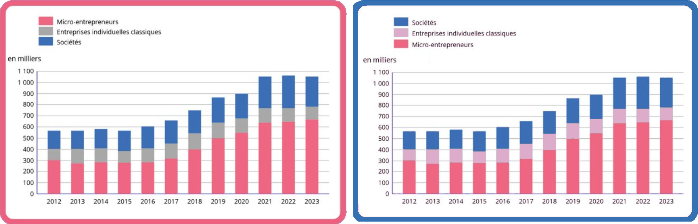
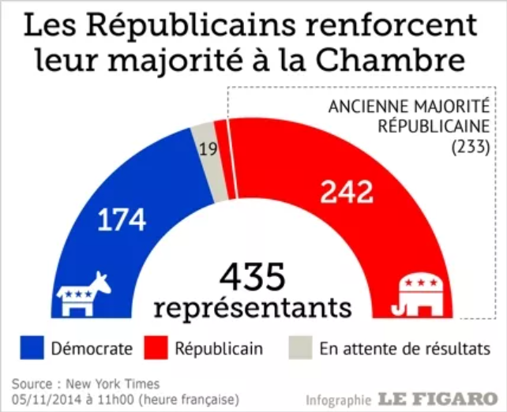
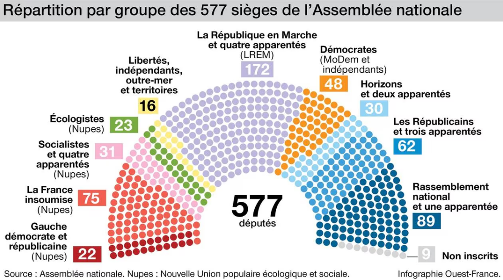
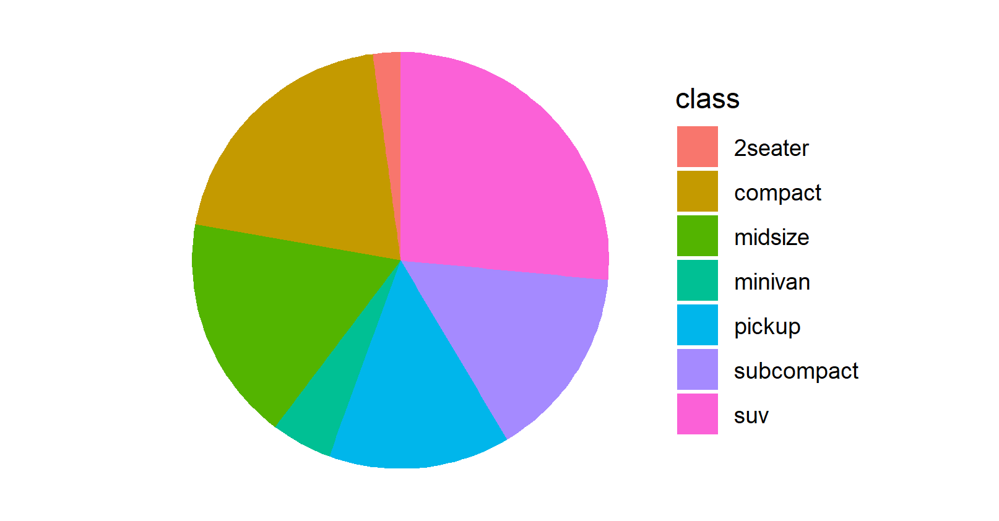
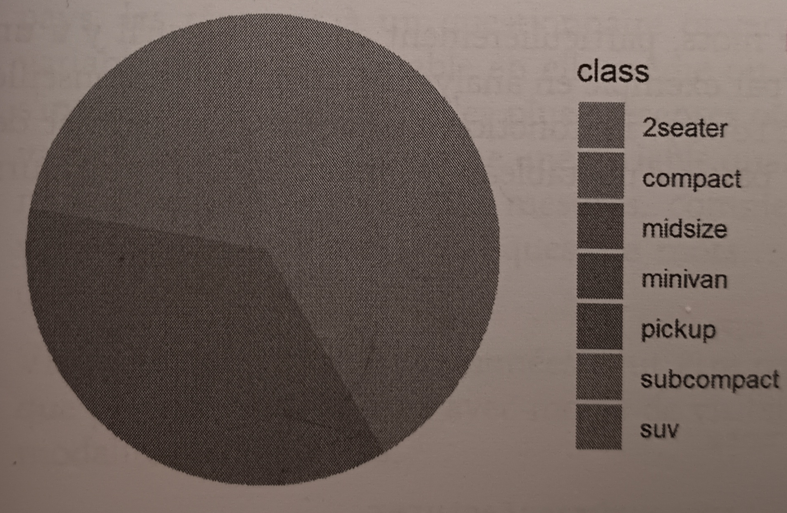
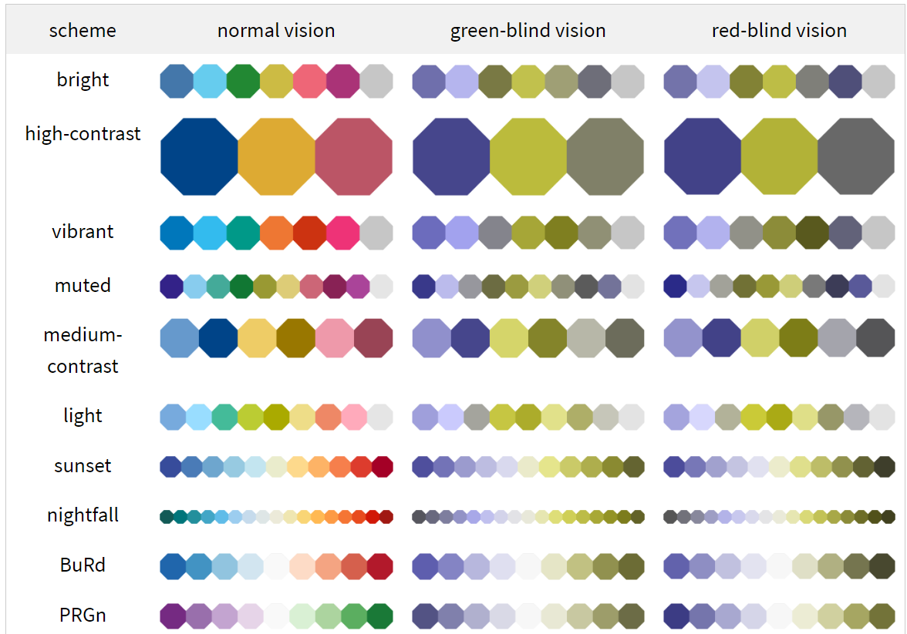
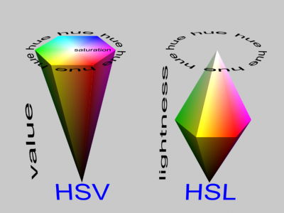

{fig-align="center"}

::: {.callout-note icon="false"}
[**Twitch du 19 mai 2026**](https://www.twitch.tv/videos/2775761352).\

Le code est disponible sur [GitHub](https://github.com/Vaugoyeau/twitch_ggplot_couleur) au format [`pdf`](https://github.com/Vaugoyeau/twitch_ggplot_couleur/blob/master/twitch_ggplot_couleur.pdf) ou [`.qmd`](https://github.com/Vaugoyeau/twitch_ggplot_couleur/blob/master/twitch_ggplot_couleur.qmd)
:::

# La dataviz et la couleur

## Avant de commencer

Si tu as déjà réalisé un graphique, quelque soit l'outil, tu as dû être confronté.e à ce choix : **faut-il conserver les couleurs par défaut ?**\
En effet dans la plus part des outils, **y compris le package `{ggplot2}`**, proposent des palettes de couleurs par défaut.

Si cela facilite la réalisation de graphiques, il ne faut pas oublier que **le choix des couleurs influence profondément la compréhension et l’interprétation** des données.

Il faut donc bien comprendre que **la couleur peut orienter la lecture graphique**.\
Lors du live sur `Twitch` j'ai montré quelques exemples, en voici d'autres tirés de ma [présentation aux rencontres R 2026 de Nantes](https://rr2026.sciencesconf.org/707373) 😊

## La couleur valorise les graphiques

Sur le graphique interactif ci-dessous, la couleur permet de voir facilement que plus les années passent plus la température globale augmente.

::: {.content-visible when-format="pdf"}
{width="50%"}
:::

En effet, la **couleur bleue** associée aux **températures plus basses** est remplacée progressivement par une **couleur rouge** pour les **températures les plus hautes**.

## Sauf quand elle perturbe le message

L'utilisation d'un cadre autour des graphiques rapellant une des couleurs utilisées conduit l’œil a percevoir les barres associées **plus grandes** qu'elles ne le sont !



::: {style="font-size: 0.5em; color: darkgrey;"}
La dataviz pour donner du sens aux données et communiquer un message – *février 2024* par **Éric MAUVIÈRE**, icem7
:::

## Sauf quand les conventions brouillent la compréhension

::: callout-note
## Gauche ou droite ?

J'avoue que j'ai mis des années à comprendre que les `républicains` aux Etats-Unis étaient de droite et non de gauche 😬
:::

Contrairement au reste du monde, le **partie de gauche** étasunien est représenté par la couleur **bleue** et le **partie de droite** en **rouge**...

::::: columns
::: {.column width="40%"}

:::

::: {.column width="50%"}

:::
:::::

## Sauf quand elle n'informe pas

Ici tu retrouve l’original et le résultat de l'impression d'un graphique de mon livre...

::::: columns
::: {.column width="60%"}

:::

::: {.column width="40%"}

:::
:::::

::: callout-tip
## Nouvelle version

J'ai le plaisir de t'annoncer que je travaille sur une nouvelle version qui n'aura plus ces erreurs et qui en plus présentera `Quarto` 🥰
:::

# Les questions à se poser

## La principale

Et oui, tu l'auras compris, la première question à se poser est de savoir si **réellement** notre graphique a **besoin de couleur** 🙂

::: callout-tip
## Si tu mets de la couleur

La couleur **ne doit pas être** la **seule façon** de passer une **information**
:::

## 5 questions essentielles à se poser

- Quel est le support de sortie ?

  - Si le graphique est **imprimé**, **projeté** sur un écran ou visible sur un smartphone, cela change tout\
  - L'impression est-elle sur papier glacé, en noir et blanc ou en niveau de gris...

- Suis-je limité.e dans les couleurs à utiliser ?

  - Si ton entreprise te limite dans le choix d'une couleur, tu peux utiliser le package [`{monochromeR}`](https://github.com/cararthompson/monochromeR) pour trouver des couleurs proches mais plus ou moins attenuées, mélangées à une autre couleur....\
  - Limites toi à 8 couleurs max 🎨

- Les couleurs sont-elles distinctes (pour les personnes daltoniennes mais aussi pour les autres) ?\
  {.absolute top="290" right="0" width="40%"}

- Les teintes sont-elles cohérentes avec l'information ?

  - Fais particulièrement attention au couple **rouge-bleu**\
  - Soit attentif au sens derrière en fonction du public

- L'intensité des couleurs sont-elles équilibrées entre elles ?

  - Lorsque qu'une variable augmente, par convention, les **plus petites valeurs** sont en **plus clairs**\
  - L'intensité se compare facilement en utilisant le code [`hsl` de la couleur](Colorimétrie%20:%20Classification%20des%20couleurs)\
    [](https://www.reddit.com/r/css/comments/tjadsb/is_hsl_the_same_as_hsv/?tl=fr)

# Utiliser de la couleur dans un graphique

Exemple réalisé en [live](https://019e9732-679c-fb68-338e-85c2927b7171.share.connect.posit.cloud/)

```{r}
#| label: fig_sans_couleur
#| output-location: column

library(tidyverse)

penguins |> 
  ggplot() +
  aes(
    x = flipper_len,
    y = body_mass
  ) +
  geom_point() +
  theme_classic() +
  labs(
    title = "Condition corporelle des pingouins",
    x = "taille de la nageoire (mm)",
    y = "masse (g)"
  )

```

Pour pouvoir différencier les espèces il faut utiliser un paramètre graphique comme la **forme des points** ou la **couleur**.

## Modification de la forme des points  
  
```{r}
#| label: fig_forme_point
#| output-location: column

library(tidyverse)

penguins |> 
  ggplot() +
  aes(
    x = flipper_len,
    y = body_mass,
    shape = species
  ) +
  geom_point() +
  theme_classic() +
  labs(
    title = "Condition corporelle des pingouins",
    x = "taille de la nageoire (mm)",
    y = "masse (g)"
  )

```

::: {.callout-note appearance="minimal"}
Le problème c'est que la **distinction ne se fait pas bien**.\
La couleur est un des critères qui permet une distinction facile.
:::

## Ajout de la couleur automatiquement

```{r}
#| label: fig_couleur
#| output-location: column

library(tidyverse)

penguins |> 
  ggplot() +
  aes(
    x = flipper_len,
    y = body_mass,
    shape = species,
    color = species
  ) +
  geom_point() +
  theme_classic() +
  labs(
    title = "Condition corporelle des pingouins",
    x = "taille de la nageoire (mm)",
    y = "masse (g)"
  )

```

::: {.callout-warning appearance="minimal"}
Lorsqu'une couleur est affectée automatiquement, elle n'est pas gardé entre les graphiques, par exemple entre @fig_couleur et @fig_couleur_varie.
:::

```{r}
#| label: fig_couleur_varie
#| output-location: column

library(tidyverse)

penguins |> 
  filter(species != "Adelie") |> 
  ggplot() +
  aes(
    x = flipper_len,
    y = body_mass,
    shape = species,
    color = species
  ) +
  geom_point() +
  theme_classic() +
  labs(
    title = "Condition corporelle des pingouins",
    x = "taille de la nageoire (mm)",
    y = "masse (g)"
  )

```

Il est donc préférable de définir une palette par modalité.

## Création d'une palette  

```{r}
#| label: fig_couleur_palette
#| output-location: column

library(tidyverse)

vecteur_couleur <- c(
  "Adelie" = "blue",
  "Chinstrapp" = "red",
  "Gentoo" = "green"
)

penguins |> 
  filter(species != "Adelie") |> 
  ggplot() +
  aes(
    x = flipper_len,
    y = body_mass,
    shape = species,
    color = species
  ) +
  geom_point() +
  scale_color_manual(values = vecteur_couleur) +
  theme_classic() +
  labs(
    title = "Condition corporelle des pingouins",
    x = "taille de la nageoire (mm)",
    y = "masse (g)"
  )

```

La moindre erreur de frappe fait `disparaitre` la modalité en la transformant en gris, la couleur des `valeurs manquantes` par défaut.

```{r}
#| label: fig_couleur_palette_corr
#| output-location: column

library(tidyverse)

vecteur_couleur <- c(
  "Adelie" = "blue",
  "Chinstrap" = "red",
  "Gentoo" = "green"
)

penguins |> 
  filter(species != "Adelie") |> 
  ggplot() +
  aes(
    x = flipper_len,
    y = body_mass,
    shape = species,
    color = species
  ) +
  geom_point() +
  scale_color_manual(values = vecteur_couleur) +
  theme_classic() +
  labs(
    title = "Condition corporelle des pingouins",
    x = "taille de la nageoire (mm)",
    y = "masse (g)"
  )

```

## Accessibilité d'une palette  
Pour vérifier la compatibilité d'une palette au près des personnes daltonniennes tu peux utiliser le package [`{colorblindcheck}`](https://jakubnowosad.com/colorblindcheck/)

```{r}
#| label: fig_couleur_palette_blindcheck
#| output-location: column

library(tidyverse)

vecteur_couleur <- c(
  "Adelie" = "blue",
  "Chinstrap" = "red",
  "Gentoo" = "green"
)

colorblindcheck::palette_plot(vecteur_couleur)

penguins |> 
  # filter(species != "Adelie") |> 
  ggplot() +
  aes(
    x = flipper_len,
    y = body_mass,
    shape = species,
    color = species
  ) +
  geom_point() +
  scale_color_manual(values = vecteur_couleur) +
  theme_classic() +
  labs(
    title = "Condition corporelle des pingouins",
    x = "taille de la nageoire (mm)",
    y = "masse (g)"
  )

```

# Pour finir

Et voilà, n'hésites pas à me faire des retours sur [contact\@marievaugoyeau.fr](mailto:contact@marievaugoyeau.fr) ou [LinkedIn](https://www.linkedin.com/in/marie-vaugoyeau-72ab64153/) ✍️

::: callout-note
Tu peux aussi t'inscrire à la [newsletter](https://mvaugoyeau.kessel.media?source_type=social_network) pour être au courant du prochain live 📺

<iframe src="https://mvaugoyeau.kessel.media/iframe?displayContext=false" width="480" height="130" frameborder="0" scrolling="no">

</iframe>
:::

Bonne journée 😊
