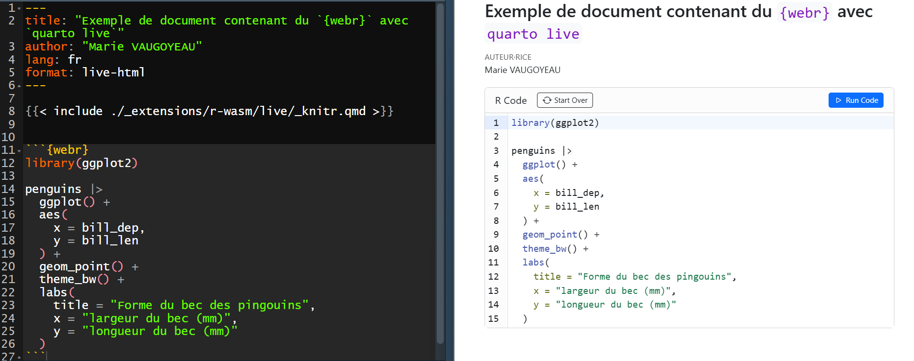
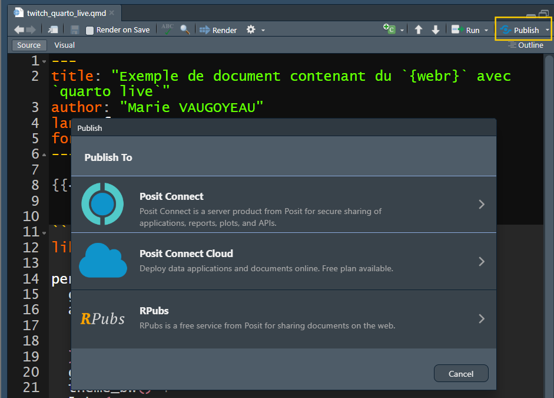

{fig-align="center"}  
  
::: {.callout-note icon="false"}
[**Twitch du 23 juin 2026**](https://www.twitch.tv/videos/2808048300).\

**Attention** j'ai eu un souci lors du live donc il n'y a pas de fin pour la vidéo, désolée 😬  
   
Le code est disponible sur [GitHub](https://github.com/Vaugoyeau/twitch_quarto_live) 😊  
:::
  
# Du code actif dans une page web     
## L'idée   
Lors des rencontres R de Nantes, j'ai eu l'occasion de montrer [comment choisirles couleurs dans les graphiques {ggplot2}](https://rr2026.sciencesconf.org/707373).  
Pour cette présentation, j'ai montré des lignes de code que tout le monde a pu s'approprier et manipuler en direct grâce à [quarto live](https://r-wasm.github.io/quarto-live/).  
  
## Le principe  
L'extension `quarto live` permet d'utiliser du code `R` actif et modifiable dans un document quarto en s'appyant sur [{webr}](https://docs.r-wasm.org/webr/latest/) compilé au format `wasm` (`WebAssembly`).  
  
::: callout-note
## Pour la petite histoire  

[Cara Thompson](https://www.linkedin.com/in/cararthompson/) m'a appris lors des RR que [{webr}](https://docs.r-wasm.org/webr/latest/) avait été développé pendant les confinements pour que les étudiant.e.s puissent coder en `R` sans installation (sa première version date de 2023).    
:::  
  
J'utilise `quarto live` car c'est bien plus simple que d'utiliser directement `{webr}` 😅  
  
  
## La procédure    
  
::: callout-tip
## Avant de commencer  

Pour ajouter du code interactif à des supports `html` il faut donc utiliser `quarto`.  
  
Si tu ne connais pas bien `quarto` et que tu as besoin de te former, je t'invite à aller voir à suivre [ma formation en ligne 😊](https://marievaugoyeau.teachizy.fr/formations/creer-des-scripts-reproductibles-repetables-et-reutilisables-grace-a-quarto)  
:::
  
- Créer un projet `quarto`  
- Installer `quarto live` (c'est ce que je n'ai pas réussi à faire bien lors du live, sûrement à cause de souci de réseau)  
- Rédiger un document avec du code  
- Mettre en ligne  
  
# Mise en pratique  
## Créer un projet `quarto`    
  
Il y a trois possibilité pour le faire, à toi de voir celle que tu préfères :  

- **cliquer sur l'icône bleue `projet`** en haut à droite puis `New Project...`  
- **cliquer sur le raccourci** (cube bleu avec une crois blanche dans un rond vert) `Create a projet`  
- dans le menu `File > New Project...`  
   
Ensuite, il faut cliquer sur `Quarto project`.   

::: callout-tip
## Pourquoi travailler dans un projet ?  

Travailler sous forme de projet dans `RStudio` **augmente la reproductibilité**, **facilite la transmission** et **améliore la stabilité**.   
  
Lorsque tu travailles dans un projet, tu utilises un *dossier*. Le code développé  dans un projet n'interagira pas avec un autre projet.  
:::  

  
## Installer `quarto live`   
Dans la vidéo c'est le souci que j'ai eu...  
`quarto live` est une extension de `quarto`.  
Pour être utilisée elle doit-être dans le dossier du projet.  
  
Tu dois taper dans la partie `Terminal`  

```
quarto add r-wasm/quarto-live
```
  
Pour t'aider, j'ai tourné une vidéo courte  
Je te retranscrit juste en dessous les codes que j'utilise 😊  
  
   
 
  
## Rédiger un document avec du code    
Maintenant que `quarto live` est installé, je modifie le document quarto pour coller à ce que j'ai présenter lors du live.  
  
Je modifie l'en-tête pour écrire un titre plus intéressant, ajouter mon nom et la langue.  
Il faut aussi ajouter `live-html` comme format.  
  
```
---
title: "Exemple de document contenant du `{webr}` avec `quarto live`"
author: "Marie VAUGOYEAU"  
lang: fr
format: live-html
---
```
Sous l'en-tête, j'ajoute aussi l'extension à utiliser   
  
``  
  
Puis je rajoute un chunk de code `{webr}` contenant le code ci-dessous :   
  
```{r}
library(ggplot2)

penguins |> 
  ggplot() +
  aes(
    x = bill_dep,
    y = bill_len
  ) +
  geom_point() +
  theme_bw() +
  labs(
    title = "Forme du bec des pingouins",
    x = "largeur du bec (mm)",
    y = "longueur du bec (mm)"
  )
```

  
  
## Mettre en ligne   
Une fois le support créé, il est possible de le mettre en ligne sur un site internet ou de le déployer sur [`Posit Connect Cloud`](https://connect.posit.cloud/).  
  
L'avantage de `Posit Cloud` c'est que c'est très imple depuis `RStudio`, il suffit de cliquer sur `Publish` en haut à droite du document puis sur `Posit Connect Cloud`, après tous est décrit !  
  
  
L'autre avantage c'est qu'il y a la possibilité de déployer *gratuitement* plusieurs documents pour tester (comme `shinyapps.io` si tu connais) 🥰  
  

# Pour finir

Et voilà, n'hésites pas à me faire des retours sur [contact\@marievaugoyeau.fr](mailto:contact@marievaugoyeau.fr) ou [LinkedIn](https://www.linkedin.com/in/marie-vaugoyeau-72ab64153/) ✍️

::: callout-note
Tu peux aussi t'inscrire à la [newsletter](https://mvaugoyeau.kessel.media?source_type=social_network) pour être au courant du prochain live 📺

<iframe src="https://mvaugoyeau.kessel.media/iframe?displayContext=false" width="480" height="130" frameborder="0" scrolling="no">

</iframe>
:::

Si tu as besoin d'aide pour te former à `quarto`, jette un œil [à ma formation 😉](https://marievaugoyeau.teachizy.fr/formations/creer-des-scripts-reproductibles-repetables-et-reutilisables-grace-a-quarto)  
  
Bonne journée 😊   
  