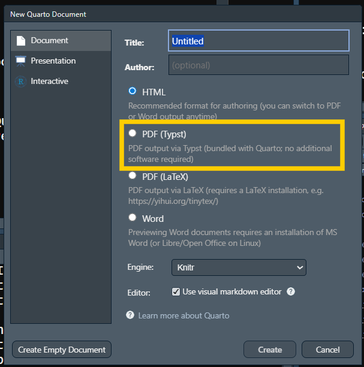

{fig-align="center"}

::: {.callout-note icon="false"}
[**Twitch du 14 septembre 2026**](https://www.twitch.tv/videos/2873957633).\

Le code est disponible sur [GitHub](https://github.com/Vaugoyeau/twitch_typst) 😊
:::

# C'est quoi `Typst` ?

::: callout-note
[`Typst`](https://typst.app/) est un logiciel de compilation de documents `PDF` développé en *open-source* et sortie en **2023**.
:::

Dès **juillet 2024**, il est inclut dans Quarto.\
Depuis **juillet 2026**, il apparaît à la création de nouveau documents `Quarto` via `(File \>) New File \> Quarto Documents...`.\
{width="300"}  
  
::: callout-tip
## Différence entre `typst` et `LaTeX`

Avant `typst` pour générer un pdf, il fallait utiliser un logiciel `LaTeX` tel que `MiKTeX` : `.qmd` -\> *pandoc* -\> `.md` -\> `.tex` -\> *LaTeX* -\> `pdf`\
Avec `typst`, le passage est direct depuis *pandoc* et tout est contenu dans `quarto` : `.qmd` -\> *pandoc* -\> `.typ` -\> *typst* -\> `pdf`
:::
  
Le grand avantage de `typst` est sa compilation **plus rapide** !  
L'autre avantage est une mise en forme et une personnalisation plus facile.  
En effet, comme il est inclus dans `quarto` la **mise en forme du fichier `_brand.yml` s'applique** et ça c'est une super nouvelle !  

  
## Paramétrer le format

Les paramètres à utiliser sont similaires à ceux du format `pdf` 😊\
Comme ajouter :  
  
- un sommaire avec `toc: true`\
- une numérotation automatique avec `number-sections: true`\

Il est aussi possible de modifier :  

- la langue des textes par défaut avec `lang: fr`  
- la police utilisée avec `mainfont: Arial`  
  
    
Et puis il y a des choses différentes, maintenant plus simple, comme :  

- le nombre de colonnes avec `columns: 2`   
- le format de la numérotation automatique `section-numbering: A. 1. a`  


::: callout-tip
## Différences sympa  

- Les émojis peuvent-être utilisés dans `typst` 🥰  
- La liste à puces est vraiment avec des puces et non pas des tirets  
:::  

  
## Modifier le style  
La façon la plus simple de modifier le style d'un document (et qu'il soit appliqué aux autres formats) est d'utiliser le fichier `_brand.yaml`    
Mais bien sûr il est possible de mettre tous les modifications ci-dessous dans l'en-tête `YAML` ou encore dans le fichier `_quarto.yml`.  
  
Lors du live, j'ai montré comment créer le fichier `_brand.yml` à partir d'un fichier texte : `(File >) New File > Text File` puis en l'enregistrant sous le nom `_brand.yml` 😉  
  
Puis j'ai montré comment l'utiliser pour :  

- mettre de la couleur au texte  

```
color:
  palette:
    jaune-fonce: "#dee114" 
    bleu: "#354888"
  primary: jaune-fonce
  foreground: bleu
```

- modifier la police utilisée et sa taille    

```
typography:
  fonts:
    - family: Inter
      source: google
      weight: [400, 600, 700]
  base: Inter
  headings: 
    color: primary
```

- ajouter un logo (celui de [quarto](https://quarto.org/quarto.png))  

```
logo:
  images:
    quarto:
      path: 'quarto.png'  
```

Pour affiche le logo, il ne faut pas oublier de l'ajouter dans l'en-tête en `yaml` ou dans le fichier `_quarto.yml` :  

```
format: 
  typst: 
    logo:
      path: quarto
```

# Pour finir

Et voilà, n'hésites pas à me faire des retours sur [contact\@marievaugoyeau.fr](mailto:contact@marievaugoyeau.fr) ou [LinkedIn](https://www.linkedin.com/in/marie-vaugoyeau-72ab64153/) ✍️

::: callout-note
Tu peux aussi t'inscrire à la [newsletter](https://mvaugoyeau.kessel.media?source_type=social_network) pour être au courant du prochain live 📺

<iframe src="https://mvaugoyeau.kessel.media/iframe?displayContext=false" width="480" height="80" frameborder="0" scrolling="no">
</iframe>
:::

Si tu as besoin d'aide pour te former à `quarto`, jette un œil [à ma formation 😉](https://marievaugoyeau.teachizy.fr/formations/creer-des-scripts-reproductibles-repetables-et-reutilisables-grace-a-quarto)

Bonne journée 😊
